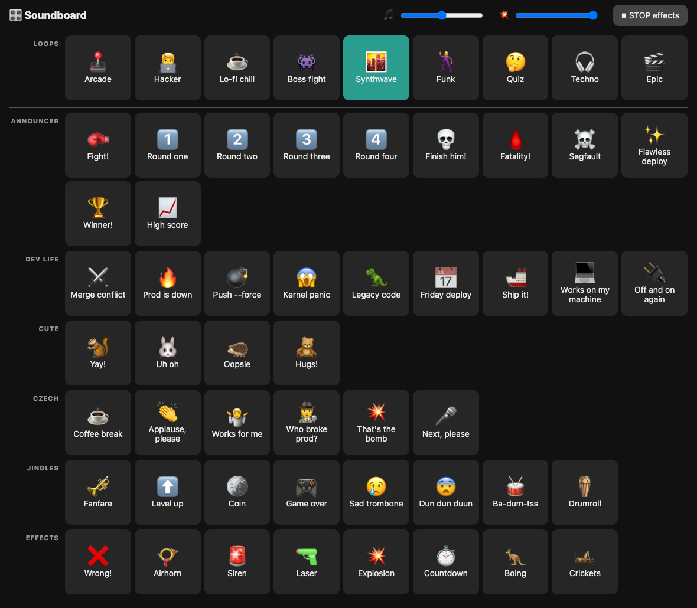

<div align="center">

# 🎛️ Soundboard

**A one-page soundboard for meetups, hackathons and community events.**
Background loops, announcer voice lines and game-show jingles: one tap each, on any laptop or tablet.
No build step, no runtime dependencies, all sounds generated from code.

[](https://hlavacm.github.io/soundboard/)
[](LICENSE)
[](https://github.com/hlavacm/soundboard)
[](#development)
[](#deploying-to-github-pages)
[](https://github.com/hlavacm/soundboard/commits/main)

[▶ Live demo](https://hlavacm.github.io/soundboard/) · [Features](#features) · [Quick start](#quick-start) · [Adding your own sounds](#adding-your-own-sounds) · [Deploying](#deploying-to-github-pages) · [Development](#development) · [License](#license)

</div>

---



## Features

- **Background loops.** Only one plays at a time. Tap another loop to crossfade to it, or tap the active one to stop it. The loops are seamless, so there is no click at the seam.
- **Effects that stack.** Voice lines, jingles and sound effects can overlap. A tile stays lit while it plays, and **⏹ STOP** silences all effects at once without stopping the music.
- **Two volume sliders.** Loops and effects are mixed separately, so you can keep the music low and the announcer loud.
- **Stays awake.** The page holds a screen wake lock, so your iPad won't dim in the middle of a talk.
- **Fits on one screen.** The layout is built for a tablet in landscape: every tile is visible, with no scrolling during the show.
- **Easy to customise.** Drop in an audio file, add one line to `sounds.json`, then reload.

## Quick start

**Just use it:** open the [live demo](https://hlavacm.github.io/soundboard/). On an iPad, choose *Share → Add to Home Screen* to launch it like an app.

**Run it locally:**

```bash
git clone https://github.com/hlavacm/soundboard.git
cd soundboard
make serve        # then open http://localhost:8000
```

`make serve` is only `python3 -m http.server 8000`, and any static file server works. Opening `index.html` directly from disk won't work, because browsers block `fetch()` on `file://` URLs.

## Adding your own sounds

1. Put an audio file (`.mp3`, `.m4a` or `.wav`) into `sounds/sfx/` or `sounds/loops/`.
2. Add an entry to [`sounds.json`](sounds.json):

   ```json
   { "group": "Announcer", "name": "Fight!", "emoji": "🥊", "file": "sounds/sfx/fight.mp3" }
   ```

3. Reload the page. If an old file is still cached, do a hard reload with <kbd>⌘</kbd><kbd>⇧</kbd><kbd>R</kbd>.

| Field   | Required | Description |
|---------|----------|-------------|
| `name`  | yes      | Label shown on the tile. |
| `file`  | yes      | Path relative to the repo root. |
| `emoji` | no       | Icon above the label (defaults to 🔊). |
| `group` | no       | Row label, for effects only. Consecutive entries with the same group share a row, in file order. Defaults to `Effects`. |

> **Tip:** use WAV for loops. MP3 adds a few milliseconds of silence at the start and end, which you can hear as a gap every time the loop repeats.

The test suite checks that `sounds.json` and the `sounds/` folder stay in sync, so a typo in a path or a forgotten file fails `make test`.

## Built-in sounds

Every bundled sound is generated by [`tools/make_sounds.py`](tools/make_sounds.py). No sound is a sample of someone else's recording:

- **Loops and jingles** are synthesized from scratch in pure Python: oscillators, noise, envelopes and a simple low-pass filter, written straight to WAV.
- **Voice lines** are spoken by the macOS `say` voices and processed with `ffmpeg`. A pitch-down with echo gives the announcer, and a pitch-up gives the cute voice.

To regenerate them, run `make sounds` on macOS with `ffmpeg` installed. To add a voice line, add a row to `VOICES` in the script; `say -v '?'` lists the voices on your system.

The *Czech* group is in Czech because this soundboard started at Czech community events. Its labels are translated in the UI.

> **About Apple voices:** the macOS voices are licensed for personal, non-commercial use. That covers playing them at a free meetup. If you plan to use the voice lines commercially, replace them with your own recordings.

### Where to find more free sounds

- [Pixabay Music](https://pixabay.com/music/search/loop/) and [Pixabay Sound Effects](https://pixabay.com/sound-effects/search/game/): free to use, no attribution required. Search for `announcer`, `jingle`, `cartoon` or `fail`.
- [Freesound, filtered to CC0](https://freesound.org/search/?q=jingle&f=license:%22Creative+Commons+0%22): public domain.

Original clips from games, films and TV shows are copyrighted. Playing them at an event counts as a public performance, even when the event is free.

## Deploying to GitHub Pages

The app is static and uses only relative paths, so it runs from any subfolder as is:

1. Push the repository to GitHub.
2. Go to **Settings → Pages → Build and deployment**, choose **Deploy from a branch**, then pick your default branch and the `/ (root)` folder.
3. Your soundboard is live at `https://<user>.github.io/<repo>/` within a minute.

The same works with Netlify, Cloudflare Pages or any static host. There's nothing to build.

## Development

```bash
make setup    # once: npm packages, a .venv with ruff + mypy, Chromium for UI tests
make test     # all checks in parallel, with a ✔/✘ summary at the end
```

`make test` prints output only for failed checks. Each check can also be run on its own:

| Target | What it does |
|---|---|
| `make lint-js`, `make lint-py` | [Biome](https://biomejs.dev/) and [Ruff](https://docs.astral.sh/ruff/) |
| `make types-js`, `make types-py` | `tsc` over the JSDoc types in the JS files, and `mypy --strict` |
| `make unit-js` | Player unit tests (`node --test` with a fake `AudioContext`), plus checks that `sounds.json` matches the files |
| `make unit-py` | `unittest` for the sound generator, and a check that every generated sound is listed in `sounds.json` |
| `make ui` | [Playwright](https://playwright.dev/) in Chromium: all sounds load, only one loop plays at a time, STOP works, tiles turn off when a sound ends |

The npm and Python packages are dev tools only. The app itself loads nothing but its own files.

### Project layout

```
index.html            page markup and styles
app.js                DOM wiring: tiles, sliders, wake lock
player.js             audio engine (Web Audio API, no DOM): loop crossfade, effect mixing
sounds.json           catalogue of all tiles
sounds/loops/         background loops (WAV)
sounds/sfx/           voice lines and jingles
tools/make_sounds.py  generator for the built-in sounds
tools/check.sh        parallel runner behind `make test`
tests/                unit, catalogue and UI tests
```

## License

[MIT](LICENSE). This covers the code and the bundled synthesized sounds. For the voice lines, see the [note about Apple voices](#built-in-sounds).
